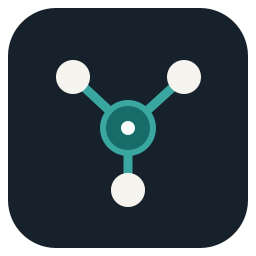

# VIRTUE WISE visual identity

## Purpose

The visual identity should communicate clarity, careful reasoning, and human agency. It should feel like a research-oriented open-source project: calm, precise, accessible, and useful rather than futuristic or promotional.

## Name and writing

- Use **VIRTUE WISE** in display copy and prose.
- Use sentence case for headings.
- Prefer concrete language and short paragraphs.
- Distinguish implemented behavior from research hypotheses and planned work.
- Avoid claims such as “revolutionary,” “fully autonomous,” or “guaranteed accurate.”

## Visual concept

The mark combines a central point with connected nodes. It represents evidence and context connected into a model that remains understandable—not a brain, robot, or all-knowing AI symbol.

Source asset: [SVG mark](../assets/virtue-wise-mark.svg).

## Core palette

| Token | Hex | Intended use |
| --- | --- | --- |
| Ink | #17212B | Primary text and dark backgrounds |
| Deep teal | #176B68 | Primary accent and links |
| Clear teal | #39A7A0 | Secondary accent and diagram highlights |
| Warm paper | #F6F4EF | Light background |
| Slate | #586574 | Secondary text |
| White | #FFFFFF | Contrast and negative space |

Always verify contrast in the actual context. Do not rely on color alone to communicate status or meaning.

## Typography

- Use a clean system sans-serif stack for web and documentation.
- Use a monospaced font only for code, identifiers, and technical values.
- Keep headings short and establish hierarchy through spacing and weight rather than decorative effects.

## Diagrams and documentation

- Prefer simple node-and-edge diagrams with explicit labels.
- Use consistent shapes for observations, hypotheses, and actions.
- Label uncertainty directly; never imply that a visual connection proves causation.
- Use accessible text alternatives for meaningful images.
- Keep diagrams editable from source when practical; SVG is suitable for simple, source-controlled marks.

## Asset rules

- Keep source assets in the repository.
- Avoid unlicensed imagery, generated fake product screenshots, and unverified badges.
- Do not add a website or social-preview claim until the corresponding destination and asset are real.
